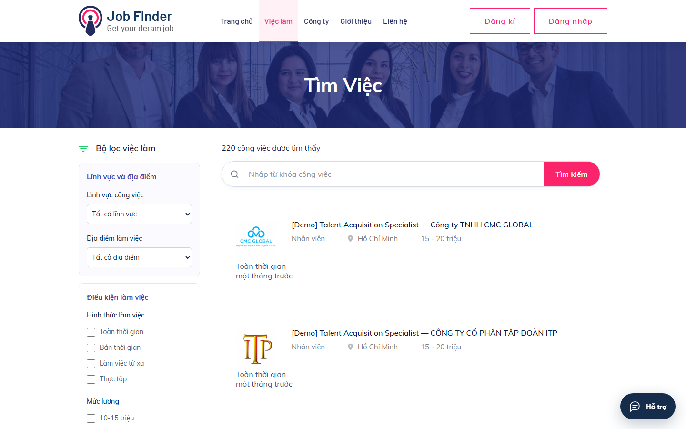
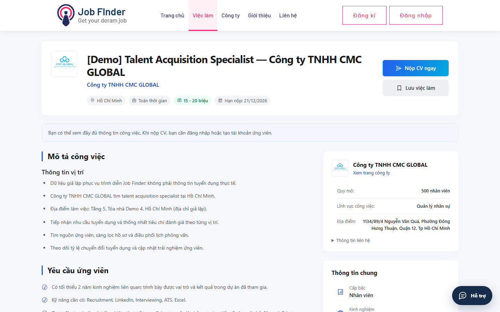
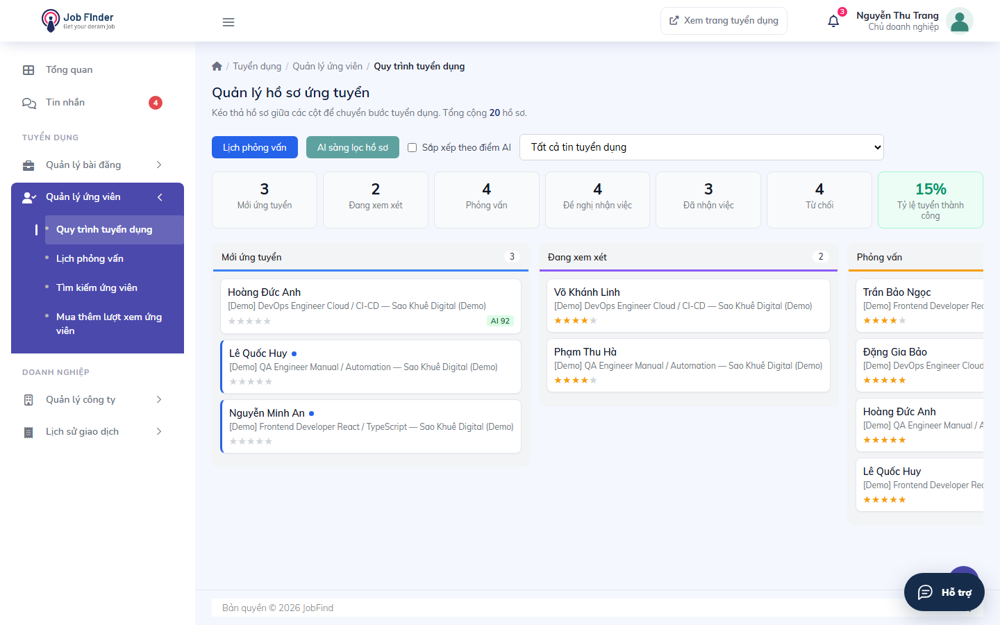
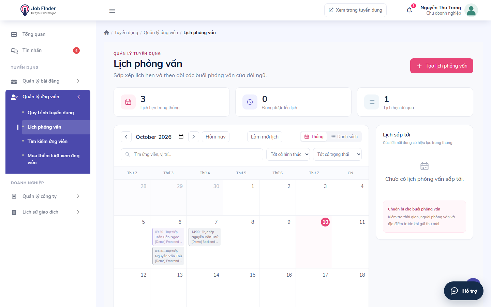
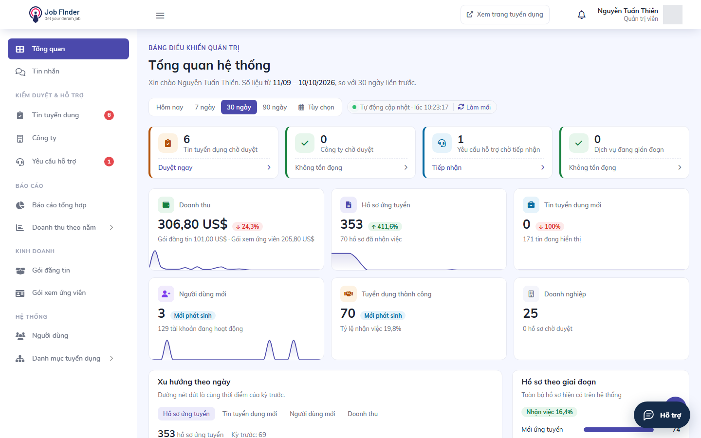
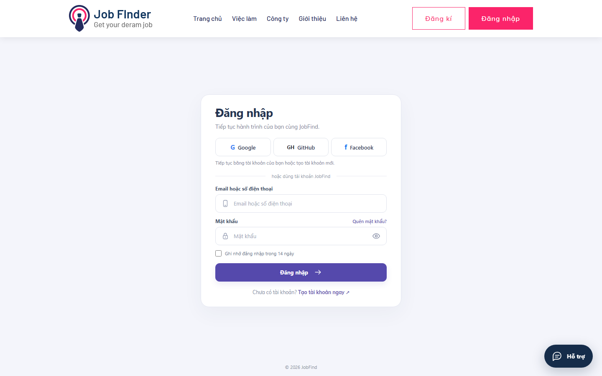
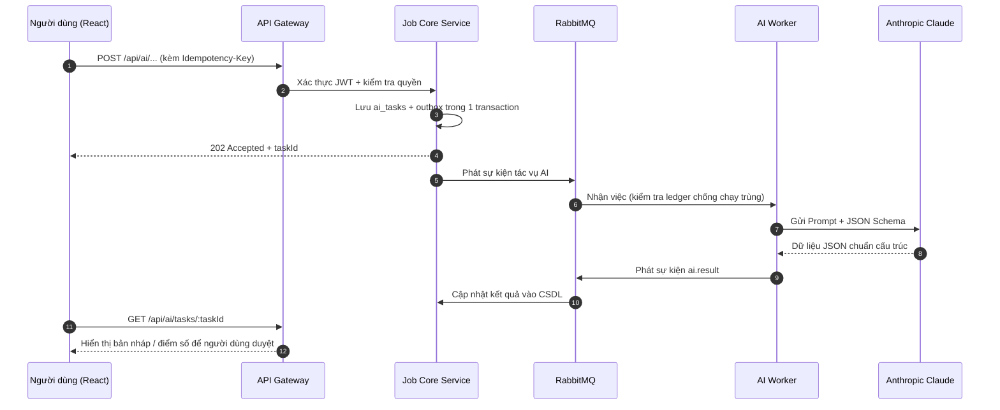
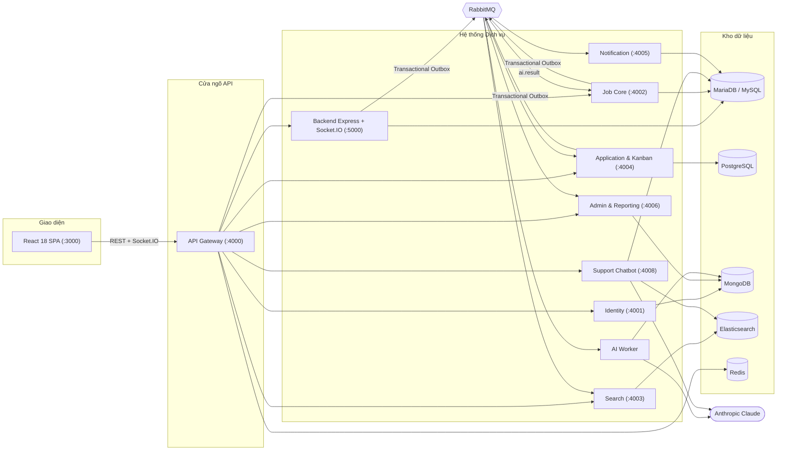

<div align="center">

# 🚀 JobFind

### Nền tảng Tuyển dụng Thông minh tích hợp AI & Thanh toán Đa kênh

**Ứng viên · Nhà tuyển dụng · Quản trị viên** — tìm việc, tạo & chấm điểm CV bằng AI, mở khóa phân tích cạnh tranh, quản lý Kanban 6 bước, lên lịch phỏng vấn, trò chuyện realtime và thanh toán đa cổng trên cùng một hệ thống.

[](https://react.dev)
[](https://nodejs.org)
[](https://www.anthropic.com)
[](#-thanh-toán-sandbox--thẻ-dùng-thử-miễn-phí)
[](https://docs.docker.com/compose/)

[](https://mariadb.org)
[](https://postgresql.org)
[](https://mongodb.com)
[](https://elastic.co)
[](https://rabbitmq.com)
[](https://redis.io)
[](https://socket.io)
[](#-chất-lượng--triển-khai)
[](.github/workflows)

[**⚡ Bắt đầu nhanh**](#-bắt-đầu-nhanh) · [**💳 Thẻ dùng thử**](#-thanh-toán-sandbox--thẻ-dùng-thử-miễn-phí) · [**👥 Tài khoản demo**](#-tài-khoản-demo) · [**🖼 Giao diện**](#-giao-diện-nổi-bật) · [**🎨 UI/UX**](#-thiết-kế-uiux) · [**🤖 AI**](#-trợ-lý-ai-trong-jobfind) · [**🧱 Kiến trúc**](#-kiến-trúc-hệ-thống)

</div>

---

## 🌟 Tổng quan nhanh

JobFind kết hợp giao diện **React 18**, **Backend Express + Socket.IO** và hệ **API Gateway cùng 8 Microservice** giao tiếp qua **RabbitMQ**. Trí tuệ nhân tạo (**Anthropic Claude**) đóng vai trò trợ lý xuyên suốt từ bước chuẩn bị CV đến sàng lọc và mời nhận việc — trong khi **con người luôn nắm quyền quyết định cuối cùng**.

| 🧩 Kiến trúc dịch vụ | 🤖 Trợ lý AI | 💳 Thanh toán & Điểm thưởng | 🧪 Kiểm thử tự động |
| :---: | :---: | :---: | :---: |
| API Gateway + 8 Microservice + Backend | 6 tác vụ AI Worker + Chatbot đa mô hình | VNPAY · ZaloPay · MoMo · PayPal + Ví Điểm | 6.500+ test · Mutation > 91% |

<table>
<tr>
<td width="33%" valign="top">

### 👤 Ứng viên
- Tìm việc đa bộ lọc (34 tỉnh/thành mới), lưu việc & theo dõi công ty.
- Tạo CV, đọc CV PDF, chấm độ hợp công việc (0–100) & viết thư ứng tuyển bằng AI.
- Tích điểm hằng ngày, nạp Xu và mở khóa **Báo cáo phân tích cạnh tranh** từng tin tuyển dụng.
- Xem lịch phỏng vấn, theo dõi tiến trình và chat realtime với HR.

</td>
<td width="33%" valign="top">

### 🏢 Nhà tuyển dụng
- Đăng tin tuyển dụng (có AI kiểm duyệt tự động), quản lý nhân sự HR trong công ty.
- Mua gói đăng tin thường/nổi bật & gói tìm CV qua **VNPAY, ZaloPay, MoMo, PayPal**, tích lũy **Top Point** đổi quà.
- Quản lý ứng viên trên bảng **Kanban 6 bước**, AI sàng lọc hàng loạt tới 50 hồ sơ/lần.
- Đặt lịch phỏng vấn, AI soạn thư mời phỏng vấn / nhận việc / cảm ơn chuyên nghiệp.

</td>
<td width="33%" valign="top">

### 🛡 Quản trị viên
- Dashboard **Việc cần xử lý**, biểu đồ doanh thu, phễu tuyển dụng & KPI so sánh cùng kỳ.
- Duyệt/từ chối/khóa tin đăng và hồ sơ pháp lý công ty.
- Quản lý người dùng, danh mục hệ thống, các gói dịch vụ đăng tin & xem CV.
- Tiếp nhận và phản hồi yêu cầu hỗ trợ chuyển tiếp từ Chatbot AI.

</td>
</tr>
</table>

---

## 🖼 Giao diện nổi bật

<table>
<tr>
<td width="50%">
  
  <br><sub><b>🔍 Tìm việc thông minh</b> — bộ lọc đa tiêu chí, gợi ý từ khóa tức thì, ưu tiên tin nổi bật</sub>
</td>
<td width="50%">
  
  <br><sub><b>📄 Chi tiết việc làm</b> — mức lương, hạn nộp, nộp CV kèm AI chấm độ phù hợp & phân tích đối thủ</sub>
</td>
</tr>
<tr>
<td width="50%">
  
  <br><sub><b>📋 Kanban tuyển dụng 6 bước</b> — kéo thả mượt, huy hiệu điểm AI 4 mức màu ngay trên thẻ</sub>
</td>
<td width="50%">
  
  <br><sub><b>📅 Lịch phỏng vấn</b> — chế độ lịch tháng & danh sách, mã màu trạng thái, xem trước thư mời</sub>
</td>
</tr>
<tr>
<td width="50%">
  
  <br><sub><b>📊 Dashboard quản trị</b> — thẻ việc cần xử lý ngay, xu hướng doanh thu và phễu chuyển đổi</sub>
</td>
<td width="50%">
  
  <br><sub><b>🔐 Đăng nhập hiện đại</b> — SĐT/Email hoặc SSO một chạm qua Google, GitHub, Facebook</sub>
</td>
</tr>
</table>

---

## 🎨 Thiết kế UI/UX

Giao diện của JobFind được xây dựng xoay quanh 4 trụ cột: **Thao tác ít chạm · Phản hồi trạng thái tức thì · Không làm mất ngữ cảnh · AI minh bạch, dễ kiểm soát**.

### 🧭 6 Nguyên tắc trải nghiệm cốt lõi

| Nguyên tắc | Cách thể hiện trên sản phẩm |
| :--- | :--- |
| 👀 **Người dùng luôn kiểm soát** | Kết quả AI luôn mở trong khung gợi ý riêng với nút **Dùng nội dung này** / **Bỏ qua** — không bao giờ tự ghi đè hay tự gửi thư. |
| 🏷 **Nhận diện AI nhất quán** | Huy hiệu **AI** tông xanh ngọc đồng bộ ở mọi màn hình, nói rõ dữ liệu nào được dùng để phân tích. |
| ⏳ **Phản hồi trạng thái sống động** | Skeleton loading, trạng thái *"AI đang chấm…"*, nút **Dừng chờ**, điểm khớp trên thẻ Kanban tự nhảy realtime khi xong. |
| 💸 **Minh bạch khi thanh toán & dùng điểm** | Gợi ý sẵn **thẻ dùng thử miễn phí** kèm nút **Sao chép 1 chạm**, tính trước ưu đãi giảm giá và số Điểm / Top Point nhận thêm. |
| 🔁 **Bền vững khi mạng chập chờn** | Tự động gửi lại với cùng `Idempotency-Key` (không trừ tiền/tạo tác vụ trùng); tin nhắn chat lỗi giữ nguyên nội dung để thử lại. |
| ♿ **Đa thiết bị & Truy cập chuẩn (A11y)** | Tương thích Desktop / Tablet / Mobile, hỗ trợ bàn phím trên Kanban & Modal, đầy đủ `aria-label`, `role="status"`, `role="alert"`. |

### 🗺 Điểm nhấn UI/UX theo từng phân hệ

<table>
<tr>
<td width="50%" valign="top">

#### 🧑 Trải nghiệm Ứng viên
- **🏠 Trang chủ & Tìm việc**: Giữ nguyên bộ lọc, số trang và vị trí cuộn khi bấm xem chi tiết rồi quay lại.
- **📨 Nộp CV có Trợ lý AI**: Xem trước PDF trực tiếp, gợi ý 2 phương án lời giới thiệu ngắn gọn và chấm điểm khớp JD ngay tại modal nộp đơn.
- **🏆 Ví Điểm & Phân tích đối thủ**: Điểm danh hằng ngày (+1 điểm), hoàn thiện hồ sơ (+20 điểm), mở khóa biểu đồ kinh nghiệm & mức lương kỳ vọng của nhóm ứng viên cùng ứng tuyển.
- **💬 Chat & Chatbot nổi**: Cửa sổ chat 2 cột kiểu Messenger (báo đã xem, đang gõ, đính kèm CV/thẻ việc làm) cùng widget Chatbot hỗ trợ Markdown ở góc phải.

</td>
<td width="50%" valign="top">

#### 🏢 Trải nghiệm Nhà tuyển dụng & Quản trị
- **📋 Bảng Kanban trực quan**: Kéo thả 6 cột có mã màu riêng, mở chi tiết hồ sơ ngay trong modal không rời bảng; nút **AI sàng lọc** và **Sắp xếp theo điểm AI**.
- **✉️ Luồng gửi kết quả an toàn**: 3 mẫu thư tách biệt (*Mời phỏng vấn · Mời nhận việc · Cảm ơn*), xem trước giao diện thẻ email HTML (chuẩn Gmail/Outlook) trước khi bấm gửi.
- **💳 Thanh toán & Hạng đối tác**: Nạp gói tin/CV với 4 cổng thanh toán, tự động nâng hạng Đồng → Bạc → Vàng → Kim Cương và đổi Top Point lấy lượt đăng tin miễn phí.
- **🛡 Bảo mật phiên trực quan**: Quản lý các thiết bị đang đăng nhập, thu hồi từng phiên từ xa và liên kết tài khoản Google / GitHub / Facebook.

</td>
</tr>
</table>

---

## 💳 Thanh toán Sandbox & Thẻ dùng thử miễn phí

Dự án đã tích hợp chế độ **Merchant dùng thử (Sandbox)** cho cả 4 cổng thanh toán (**ZaloPay · VNPAY · MoMo · PayPal**), áp dụng cho:
1. **Ứng viên**: Nạp Điểm / Mua Xu mở khóa báo cáo cạnh tranh (`PointTopupModal`).
2. **Nhà tuyển dụng**: Mua gói lượt đăng bài thường/nổi bật (`/admin/buy-post`) và mua gói lượt tìm CV (`/admin/buy-cv`).

> [!TIP]
> Ngay trên giao diện thanh toán của ứng dụng cũng đã hiển thị sẵn khung **Thẻ dùng thử cấp sẵn miễn phí** kèm nút **Sao chép** để bạn dán nhanh khi kiểm thử.

### 🟢 Bảng thẻ dùng thử miễn phí (Giao dịch Thành công)

| Cổng thanh toán | Loại thẻ / Ngân hàng chọn trên cổng | Số thẻ dùng thử | Tên chủ thẻ | Ngày phát hành / Hết hạn | Mã OTP / CVV |
| :--- | :--- | :--- | :--- | :---: | :---: |
| **ZaloPay** *(Merchant Trial V2)* | Thẻ ATM nội địa (NAPAS) | `9704540000000062` | `NGUYEN VAN A` | `10/18` *(Phát hành)* | `123456` *(hoặc theo màn hình)* |
| **ZaloPay** *(Thẻ phụ ATM)* | Thẻ ATM nội địa (NAPAS) | `9704540000000070` | `NGUYEN VAN A` | `10/18` *(Phát hành)* | `123456` |
| **ZaloPay** *(Quốc tế)* | Thẻ VISA / MasterCard | `4111111111111111` | `NGUYEN VAN A` | `01/28` *(Hết hạn)* | CVV `123` |
| **VNPAY** *(Sandbox)* | Ngân hàng Quốc Dân (**NCB**) | `9704198526191432198` | `NGUYEN VAN A` | `07/15` *(Phát hành)* | OTP `123456` |
| **VNPAY** *(NAPAS)* | Thẻ nội địa NAPAS / VietinBank | `9704000000000018` | `NGUYEN VAN A` | `03/07` *(Phát hành)* | OTP `otp` |
| **VNPAY** *(Quốc tế)* | Thẻ quốc tế VISA *(No 3DS)* | `4456530000001005` | `NGUYEN VAN A` | `12/26` *(Hết hạn)* | CVV `123` |
| **MoMo** *(Merchant Trial)* | Thẻ ATM nội địa (NAPAS) | `9704000000000018` | `NGUYEN VAN A` | `03/07` *(Phát hành)* | OTP `000000` *(hoặc `123456`)* |
| **MoMo** *(Quốc tế)* | Thẻ VISA / MasterCard | `4111111111111111` | `NGUYEN VAN A` | `12/28` *(Hết hạn)* | CVV `123` · OTP `000000` |
| **PayPal** *(Sandbox)* | PayPal Card / Tài khoản Buyer | `4032039935147760` | `NGUYEN VAN A` | `12/28` *(Hết hạn)* | CVV `123` |

<details>
<summary><b>🔴 Bảng thẻ test kịch bản lỗi & Mã giảm giá (Promo Codes) dùng khi test</b></summary>

#### 1. Thẻ kiểm thử giao dịch thất bại (Từ chối / Không đủ số dư / Thẻ khóa)

| Cổng thanh toán | Kịch bản kiểm thử | Số thẻ | Chủ thẻ | Ngày phát hành | OTP |
| :--- | :--- | :--- | :--- | :---: | :---: |
| **VNPAY** | Tài khoản không đủ số dư *(Mã lỗi 51)* | `9704195798459170488` | `NGUYEN VAN A` | `07/15` | `123456` |
| **VNPAY** | Thẻ đang bị khóa / chưa kích hoạt | `9704193370791314` | `NGUYEN VAN A` | `07/15` | `123456` |
| **ZaloPay** | Tài khoản thẻ không đủ số dư | `9704540000000047` | `NGUYEN VAN A` | `10/18` | `123456` |

#### 2. Mã ưu đãi (Promo Codes) tích hợp sẵn

| Mã ưu đãi | Mức giảm | Đơn tối thiểu | Cổng áp dụng |
| :--- | :---: | :---: | :--- |
| `VNPAY5K` | `-5.000đ` | `20.000đ` | Chỉ VNPAY |
| `MOMO5K` | `-5.000đ` | `20.000đ` | Chỉ MoMo |
| `ZALOPAY5K` | `-5.000đ` | `20.000đ` | Chỉ ZaloPay |
| `ARCHITECT5K` | `-5.000đ` | `20.000đ` | Tất cả các cổng |
| `JOBFIND10K` | `-10.000đ` | `50.000đ` | Tất cả các cổng |

#### 3. Lưu ý cấu hình khóa Sandbox trong `backend/.env`
- **ZaloPay (`2554`)**, **MoMo (`MOMO`)** và **PayPal (`sandbox`)**: Đã điền sẵn khóa Merchant Trial chính thức — mở trực tiếp cổng thanh toán thật của nhà cung cấp.
- **VNPAY**: Do VNPAY cấp mã Terminal riêng theo từng email đăng ký, bạn có thể nhận miễn phí `VNP_TMN_CODE` & `VNP_HASH_SECRET` trong 1 phút tại https://sandbox.vnpayment.vn/devreg/ rồi điền vào `backend/.env`. Khi để trống ở môi trường dev, hệ thống tự động mở **Form nhập thẻ dùng thử VNPAY tích hợp sẵn** để bạn vẫn test trọn vẹn luồng cộng điểm & gói dịch vụ.

</details>

---

## 👥 Tài khoản demo

> [!WARNING]
> Các tài khoản dưới đây chỉ dùng cho môi trường phát triển & trình diễn local. Hãy đổi toàn bộ mật khẩu trước khi vận hành thực tế.

### 1. Bộ dữ liệu demo đầy đủ (`npm run seed:demo-data`) — Mật khẩu: `Demo@123456`

| Vai trò | Số điện thoại đăng nhập | Gợi ý trải nghiệm nhanh |
| :--- | :--- | :--- |
| 🏢 **Nhà tuyển dụng (Chủ công ty)** | `0918800001` → `0918800008` | `0918800001` *(Sao Khuê Digital)* — có sẵn Kanban đủ 6 bước, lịch phỏng vấn & hồ sơ để test **AI sàng lọc** |
| 👔 **Nhân viên tuyển dụng (HR)** | `0938800001` → `0938800008` | Thuộc cùng công ty tương ứng với chủ công ty bên trên |
| 👤 **Ứng viên** | `0928800001` → `0928800072` | `0928800001` *(Nguyễn Minh An)* — có sẵn CV, lịch sử ứng tuyển & ví điểm |

### 2. Tài khoản mặc định sẵn có — Mật khẩu: `123456`

| Vai trò | Số điện thoại |
| :--- | :--- |
| 🛡 **Quản trị viên (Admin)** | `0795095049` |
| 🏢 **Nhà tuyển dụng** | `0795095042` |
| 👤 **Ứng viên** | `0764188123` |

---

## 🤖 Trợ lý AI trong JobFind

AI chạy tách biệt trong **`ai-worker`** (không mở cổng HTTP) và nhận việc qua hàng đợi **RabbitMQ**, giúp lưu lượng gọi AI lớn không bao giờ làm nghẽn API chính.

| Tác vụ AI Worker | Sự kiện RabbitMQ | Đầu ra có cấu trúc (JSON Schema) |
| :--- | :--- | :--- |
| **Resume Parser** | `ai.parse_resume` | Bóc tách CV PDF thành hồ sơ JSON có cấu trúc |
| **CV Generator** | `ai.generate_cv` | Tạo bản nháp CV chuyên nghiệp từ thông tin ứng viên |
| **Smart Matching** | `ai.match_cv` | Chấm điểm 0–100, chỉ rõ kỹ năng khớp/thiếu & câu hỏi gợi ý khi phỏng vấn |
| **Content Moderation** | `ai.moderate_job` | Kiểm duyệt tin đăng mới, cảnh báo lừa đảo / thu phí / phân biệt đối xử |
| **Cover Letter** | `ai.cover_letter` | Soạn thư ứng tuyển cá nhân hóa (Tiếng Việt / Tiếng Anh) |
| **Writing Assistant** | `ai.write_assist` | Viết lời giới thiệu nộp đơn, soạn email kết quả & gợi ý trả lời chat |



> [!IMPORTANT]
> **Nguyên tắc an toàn & công bằng của AI**: AI không tự ý gửi email/tin nhắn hay loại ứng viên; không bịa đặt kinh nghiệm/mức lương ngoài hồ sơ; **tuyệt đối bỏ qua tuổi tác, giới tính, vùng miền, tôn giáo, tình trạng hôn nhân** khi chấm độ phù hợp CV.

---

## 🧱 Kiến trúc hệ thống



| Dịch vụ | Cổng | Kho dữ liệu | Vai trò chính |
| :--- | ---: | :--- | :--- |
| `api-gateway` | `4000` | Redis | Cổng duy nhất frontend gọi: JWT, RBAC, rate limit, circuit breaker, proxy Socket.IO |
| `backend` | `5000` | MySQL | Đăng nhập/SSO, Socket.IO chat, nộp CV, Ví điểm & Thanh toán (VNPAY/ZaloPay/MoMo/PayPal), Web Push |
| `identity-service` | `4001` | MongoDB | Hồ sơ ứng viên, trình tạo CV Builder |
| `job-core-service` | `4002` | MySQL | Tin tuyển dụng, hạn mức gói tin, kiểm duyệt & điều phối tác vụ AI |
| `search-service` | `4003` | Elasticsearch | Tìm kiếm toàn văn (full-text), gợi ý từ khóa, bộ lọc facet đồng bộ CQRS |
| `application-service` | `4004` | PostgreSQL | Bảng Kanban 6 bước, ghi chú nội bộ, phễu tuyển dụng, lịch & thư phỏng vấn |
| `notification-service` | `4005` | MySQL | Lưu thông báo, gửi email HTML qua Gmail SMTP & đẩy thông báo realtime |
| `admin-service` | `4006` | MongoDB / SQL | Báo cáo thống kê, dữ liệu danh mục (master data), nhật ký kiểm toán |
| `support-chat-service` | `4008` | MySQL + ES | Chatbot hỗ trợ đa nhà cung cấp (Claude/Gemini/OpenAI), chuyển tiếp nhân viên hỗ trợ |
| `ai-worker` | — | MongoDB | Xử lý bất đồng bộ 6 tác vụ AI qua RabbitMQ |

### 🛠 Công nghệ chủ đạo

| Tầng | Công nghệ sử dụng |
| :--- | :--- |
| **Frontend** | React 18.3, React Router 7, Ant Design 5, Reactstrap/SCSS, Axios, Socket.IO Client, Chart.js & Recharts, React-PDF & `pdf-lib`, `assistant-ui` |
| **Backend & Services** | Node.js ≥ 22.12, Express 5 / Express 4, Sequelize (`mysql2`), Mongoose, `pg`, `@elastic/elasticsearch`, `amqplib`, `openid-client` (OIDC/Auth0), `web-push` |
| **Thanh toán & AI** | VNPAY Pay v2.1.0 (HMAC-SHA512), ZaloPay API v2, MoMo Gateway v2, PayPal REST SDK · `@anthropic-ai/sdk`, Vercel AI SDK (`ai`), `pdfjs-dist` |
| **Hạ tầng & Kiểm thử** | MariaDB/MySQL, PostgreSQL 16, MongoDB 7, Elasticsearch 8.15, RabbitMQ 4, Redis 7, Docker Compose, Caddy 2 (Auto HTTPS) · Jest, Vitest, Playwright, Stryker |

---

## ⚡ Bắt đầu nhanh

### 1. Yêu cầu môi trường
- **Node.js** `>= 22.12`
- **Docker Desktop** (bật Compose V2, RAM khuyến nghị `>= 8 GB`)
- **XAMPP (MariaDB/MySQL)** tạo sẵn database `jobfindtest` (cổng `3333`)
- *(Tùy chọn)* `ANTHROPIC_API_KEY` để kích hoạt các tính năng AI

### 2. Tạo file cấu hình & Khởi chạy

Sao chép các file `.env.example` thành `.env` tại `backend/`, `microservices/` và `frontend/` (đảm bảo `JWT_SECRET` và `INTERNAL_SECRET` khớp nhau giữa `backend/.env` và `microservices/.env`), sau đó chạy từ thư mục gốc:

```powershell
npm start
```

Mở trình duyệt tại **http://localhost:3000**. Lệnh `npm start` tự động kiểm tra cấu hình, khởi động Docker, sao lưu DB vào `.local/backups`, dựng các microservice và bật đồng thời backend + frontend.

### 3. Các lệnh tiện ích thường dùng

```powershell
npm run seed:demo-data      # Nạp bộ công ty, ứng viên, Kanban & lịch phỏng vấn mẫu
npm run demo:show-jobs      # Hiển thị các tin tuyển dụng [Demo] (ẩn lại bằng demo:hide-jobs)
npm run dev:status          # Xem trạng thái toàn bộ cổng và dịch vụ đang chạy
npm run dev:stop            # Dừng toàn bộ ứng dụng (giữ nguyên dữ liệu)
npm run check               # Chạy toàn bộ lint + unit test + kiểm tra hợp đồng + build
```

---

## 🧪 Chất lượng & Triển khai

- **Kiểm thử tự động (`npm run check`)**: Bao phủ hơn **6.500 bài test** trên Backend (Jest), Frontend (Jest + React Testing Library), Microservices (Vitest), hành trình đầu cuối (Playwright) và kiểm thử đột biến mã bảo mật/thanh toán (Stryker Mutation > 91%) qua 4 workflow GitHub Actions.
- **Bảo mật mặc định**: Access token ngắn hạn + Refresh token `HttpOnly` xoay vòng; API Gateway tự xóa header định danh giả mạo; phân quyền kiểm tra theo công ty ở từng request; giao dịch thanh toán đối chiếu chữ ký số HMAC-SHA256 / HMAC-SHA512 và số tiền trước khi cộng quyền lợi.
- **Triển khai 1 VPS (Docker + Caddy HTTPS tự động)**:
  ```powershell
  npm run vps:env -- ten-mien-cua-ban.com   # Sinh deploy/.env kèm mật khẩu mới & chép cấu hình Sandbox/AI/SSO
  npm run vps:export-data                   # Xuất dữ liệu hiện tại để nạp lên VPS
  ```
  Xem hướng dẫn vận hành chi tiết tại [deploy/README.md](deploy/README.md), [Hướng dẫn kiểm thử](docs/testing.md) và [Tài liệu kiến trúc Microservices](microservices/README.md).

---

<div align="center">

**JobFind** — Tuyển dụng nhanh hơn, minh bạch hơn, với AI đồng hành cùng con người.

[⬆ Về đầu trang](#-jobfind)

</div>
